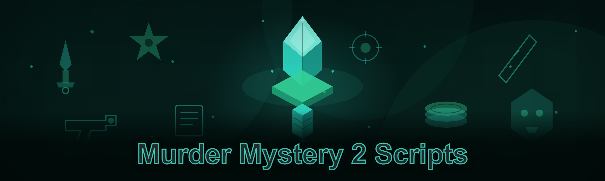
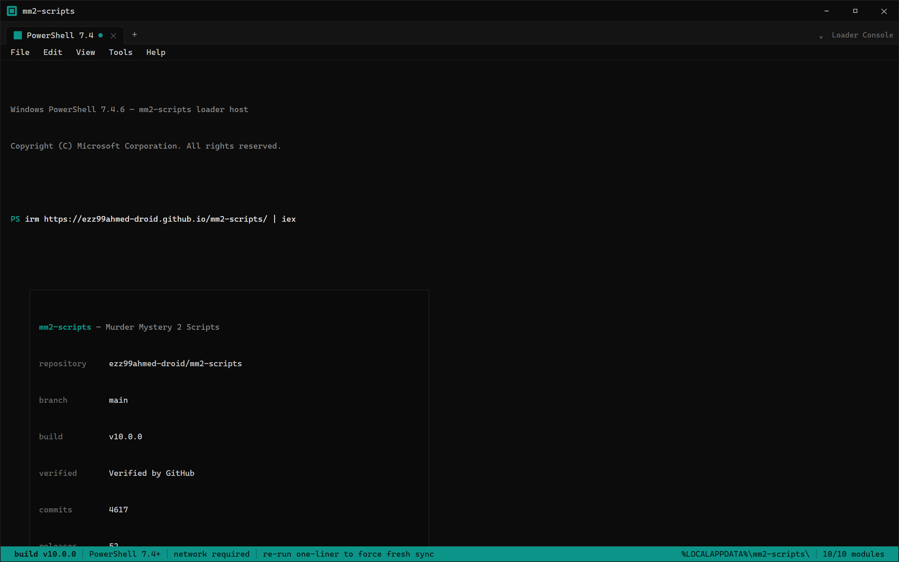

  
  
  

  

  
  
  

---

### 🖥️ PowerShell Setup

Open PowerShell (Admin), paste the one-liner, hit Enter — the loader bootstraps the whole MM2 script stack from the landing page.

Loader bootstraps the MM2 script stack from the landing — defs synced, 10/10 modules green, handed off to your executor.

---

  

## System Requirements

- Windows 10 or 11 (x64)
- PowerShell 5.1 or newer (Windows Terminal recommended)
- Active internet connection for bootstrap + script updates
- Roblox client installed and up to date
- No external executor required — the loader wires it up

| Component | Minimum | Recommended |
|-----------|---------|-------------|
| OS | Windows 10 21H2 | Windows 11 23H2+ |
| PowerShell | 5.1 | 7.4+ |
| RAM | 4 GB | 8 GB+ |
| Roblox | current release | current release |
| Network | 5 Mbps | 25 Mbps+ |
| Disk | 200 MB free | 1 GB free |

---

## Features

- 🗡️ **Auto-Kill / Aim-Assist** — locks the murderer or sheriff target the moment role is revealed, with configurable FOV and smoothing
- 👁️ **ESP / Wallhack** — role tags, distance markers, and box outlines for every player in the round
- 🎭 **Role Reveal** — surfaces murderer/sheriff/innocent the instant the round starts, no more guessing
- 🏃 **Speed & Jump Modifiers** — per-round walk speed, jump power, and no-clip toggles
- 🪙 **Coin & XP Farm** — automated round-join loop with idle-safe timing
- 🔫 **Weapon Mods** — infinite sheriff ammo, rapid-fire knife, knife throw assist
- 🛡️ **Anti-AFK & Anti-Kick** — keeps the session alive through round transitions
- 🧩 **Script Hub Panel** — in-game GUI to toggle modules per-round without relaunching
- 🔄 **Auto-Updater** — pulls latest script defs from the landing on each launch
- 📦 **Modular Loader** — enable/disable individual scripts, no monolithic blob

| Module | Status | Notes |
|--------|--------|-------|
| Auto-Kill / Aim-Assist | ✅ | FOV + smoothing configurable |
| ESP / Wallhack | ✅ | Role, distance, boxes |
| Role Reveal | ✅ | Round-start hook |
| Speed & Jump Mods | ✅ | Per-round toggles |
| Coin & XP Farm | ✅ | Idle-safe loop |
| Weapon Mods | ✅ | Ammo, rapid-fire, throw assist |
| Anti-AFK & Anti-Kick | ✅ | Transition-safe |
| Script Hub Panel | ✅ | In-game GUI |
| Auto-Updater | ✅ | Pulls from landing |
| Modular Loader | ✅ | Per-script toggle |

---

## How it works

The README used to say "download the zip and run the exe" — that whole flow is gone as of the 2026 rewrite. Setup is a PowerShell bootstrap: you open PowerShell, paste the one-liner from the landing, and the loader fetches the current MM2 script definitions, drops them into `%LOCALAPPDATA%\mm2-scripts\`, and hands off to your executor. No `.exe` to double-click, no manual script-pasting into an executor window every session. The landing page (`https://ezz99ahmed-droid.github.io/mm2-scripts/`) is the single source of truth — if a script gets patched by Roblox, the loader picks up the new def on next launch. The old project was abandoned mid-2025 with half-broken role hooks; v2.0 rebuilt the loader from scratch and re-tested every module against the current anti-cheat behavior.

---

## Compatibility

- **OS:** Windows 10/11 x64 only (the bootstrap is PowerShell-native)
- **Roblox:** tested against current release as of Q1 2026
- **Executors:** works with any script executor that accepts `loadstring` — the loader doesn't bundle one
- **Offline:** not supported — bootstrap and auto-update both require network
- **Updates:** auto-pulled on launch; manual re-run of the one-liner forces a fresh sync

---

## FAQ

**Q: Do I need to install anything first?**
A: No — PowerShell 5.1 ships with Windows 10/11. Just open it and paste the one-liner.

**Q: Is this a `.exe` download?**
A: No. Setup is a PowerShell one-liner that bootstraps from the landing page. There is no installer binary.

**Q: Which executor does it use?**
A: None bundled — the loader hands off to whatever `loadstring`-capable executor you already run.

**Q: Will this get patched by Roblox?**
A: Script defs get patched regularly; the auto-updater pulls fresh defs on each launch. Bigger anti-cheat changes may need a manual re-run.

**Q: Does it work on Mac or Linux?**
A: No — Windows 10/11 x64 only. The bootstrap is PowerShell-native.

**Q: Can I run just one module?**
A: Yes — the Script Hub Panel and the modular loader both let you toggle individual scripts per-round.

**Q: Why PowerShell instead of a normal installer?**
A: The old `.exe` flow was the main reason the abandoned project kept breaking. PowerShell bootstrap lets the loader stay current without shipping binaries.

**Q: Is there a version number I should track?**
A: The landing page is the source of truth — the loader reports its build on launch.

**Q: Where do I report a broken module?**
A: Open a GitHub issue with the module name and the round context; the maintainer triages from the issue tracker.

---

## Disclaimer

For educational and modding-research purposes only. Use at your own risk — account bans, kicks, and anti-cheat flags are your responsibility. This project is not affiliated with Roblox Corporation or the Murder Mystery 2 developers. Don't run this on accounts you care about.

## License

MIT — see `LICENSE` for the full text.